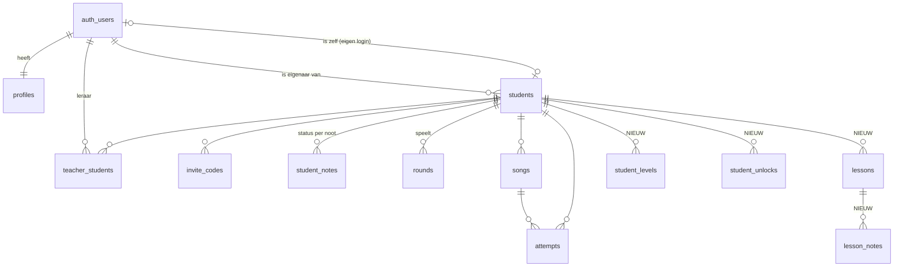

# Notenkraker — datamodel

Versie 10 oktober 2026. Bouwt voort op `supabase/migrations/0001_init.sql` en voegt toe wat de mock-ups (`docs/mockups/`) en het featureoverzicht (`docs/features.html`) nodig hebben. Alles onder "Nieuw" is een voorstel: nog geen migratie.

## Uitgangspunten

1. **Content in de repo, gebruikersdata in Postgres.** Instrumenten, niveaus en skins zijn versiebeheerde JSON met een Zod-schema. De database bewaart alleen wat een leerling doet en wat een leraar instelt.
2. **Gebeurtenissen opslaan, de rest afleiden.** Rondes zijn de bron. Sterren, XP, streak, dagdoel, zwakke noten en verwarringen worden daaruit berekend. Iets krijgt pas een eigen tabel als het een bewuste keuze is (een les, een behaald niveau, een vrijgespeelde skin).
3. **Server rekent, client toont.** Rondes en alles wat beloningen oplevert lopen via Edge Functions met dezelfde regels als `@notenkraker/core`.
4. **Zo min mogelijk kinddata (AVG).** Voornaam, geen geboortedatum (wel een leeftijdsgroep), geen e-mail voor kinderen zonder eigen login. Database in de EU-regio. Verwijderen van een leerling verwijdert alles (`on delete cascade`).

## Overzicht



Content uit de repo, waar de database met een tekst-id naar verwijst:

| Content | Pakket | Gebruikt door |
|---|---|---|
| Instrument (`altsax`) | `packages/instruments` | `students.instrument_id`, `songs.instrument_id` |
| Noot (`g4`, `fis4`) | `packages/core/music` | `student_notes.note_id`, `rounds.answers`, `lesson_notes.note_id` |
| Niveau (`altsax.3`) | `packages/instruments` (nieuw: `levels` per instrument) | `student_levels.level_id`, `rounds.level_id` |
| Skin (`notenbalk`) | `packages/themes` (nieuw) | `students.skin_id`, `student_unlocks.item_id` |

## Bestaande tabellen en wijzigingen

### `profiles`
| Kolom | Type | Status |
|---|---|---|
| `id` | uuid, = `auth.users.id` | bestaat |
| `role` | `null \| 'leerling' \| 'ouder' \| 'leraar' \| 'admin'` | gewijzigd in `0002` (AC-106). `null` = nog kiezen na Google-login. Alleen via `choose_role`/`claim_student` of door beheer te wijzigen |
| `display_name` | text | bestaat; de enige kolom die de gebruiker zelf mag wijzigen |

Het eerdere voorstel `role_confirmed` is vervallen: `role = null` zegt hetzelfde.

### `invite_codes`
| Kolom | Type | Status |
|---|---|---|
| `code`, `student_id`, `expires_at` | | bestaat |
| `purpose` | `'leraar' \| 'kind'`, default `'leraar'` | **`0002`**: `kind` laat een kind zijn eigen login koppelen (`claim_student`) |

### `students`
| Kolom | Type | Status | Waarvoor |
|---|---|---|---|
| `id`, `owner_id`, `user_id`, `name`, `instrument_id`, `naming` | | bestaat | |
| `age_band` | `'6-8' \| '9-12' \| '13+'`, null | **nieuw** | Skin-voorstellen en toon van teksten. Geen geboortedatum. |
| `skin_id` | text, default `'notenbalk'` | **nieuw** | Gekozen skin. Moet in de catalogus staan en vrijgespeeld zijn (check in Edge Function of RPC). |
| `daily_goal` | smallint, default 3, 0 = uit | **nieuw** | Dagdoel in rondes, door leraar in te stellen. |
| `time_zone` | text, default `'Europe/Amsterdam'` | **nieuw** | Om "vandaag" en de streak goed te tellen. |

### `student_notes`
| Kolom | Type | Status | Waarvoor |
|---|---|---|---|
| `student_id`, `note_id`, `status`, `updated_at` | | bestaat | |
| `introduced_at` | timestamptz, null | **nieuw** | Wanneer de mini-tutorial voor deze noot is gezien (AC-57). Null = tutorial tonen zodra de noot in het spel komt. |

De waarde `'moet'` blijft in de database; in de interface heet hij "Komt nog".

### `rounds`
| Kolom | Type | Status | Waarvoor |
|---|---|---|---|
| bestaande kolommen | | bestaat | |
| `id` | uuid | wijziging | Door de **client** gegenereerd, zodat een ronde uit de offline-wachtrij nooit dubbel wordt opgeslagen. Insert wordt `on conflict (id) do nothing`. |
| `mode` | `'buttons' \| 'mic' \| 'keys'` | wijziging | `'keys'` = antwoorden met kleppen (AC-61). |
| `level_id` | text, null | **nieuw** | In welk niveau de ronde gespeeld is (AC-59). |
| `answers[]` | jsonb | uitbreiding | Per antwoord erbij: `ms` (reactietijd) en `hint` (greep getoond). Bestaand: `expected`, `given`, `correct`. |

Score-regel erbij in `core/game.scoreRound`: een antwoord met `hint: true` telt als goed, maar geeft geen XP en de ronde kan dan niet foutloos (3 sterren) zijn. Dezelfde wijziging in `supabase/functions/rounds`.

### `songs` en `attempts`
Blijven zoals ze zijn tot de liedje-modus (AC-65). Voor bladmuziek uploaden (AC-66) komt erbij:

| Kolom | Type | Waarvoor |
|---|---|---|
| `songs.status` | `'concept' \| 'klaar'` | Na OMR eerst controleren en verbeteren. |
| `songs.source_file` | text, null | Pad in Storage-bucket `sheet-music` (privé, RLS via `can_access_student`). |

Open vraag: liedjes horen nu bij één leerling. Een leraar met meerdere leerlingen wil een liedje waarschijnlijk één keer invoeren en aan meerdere leerlingen geven. Dan wordt het `songs.owner_id` met een koppeltabel `song_students`. Beslissen vóór AC-65.

## Nieuwe tabellen

### `lessons` en `lesson_notes`: "Les van vandaag klaarzetten"
Een leraar zet na de les in één keer de nieuwe noten klaar. Dat is een bewuste handeling met een datum, dus het krijgt een eigen record. Zo zie je later ook wat er per les is gedaan.

```
lessons       id uuid pk, student_id → students, teacher_id → auth.users,
              held_on date, remark text null, daily_goal smallint null, created_at
lesson_notes  lesson_id → lessons, note_id text, status 'kent'|'les'|'moet', pk (lesson_id, note_id)
```

Opslaan via RPC `apply_lesson(student_id, held_on, notes[], daily_goal?, remark?)`. Die schrijft de les, werkt `student_notes` bij en eventueel `students.daily_goal`, in één transactie. RLS: lezen en schrijven via `can_access_student`.

### `student_levels`: behaalde niveaus
```
student_levels  student_id → students, level_id text, reached_at timestamptz, best_stars smallint,
                pk (student_id, level_id)
```
Wordt alleen door de Edge Function `rounds` geschreven, als een ronde aan de eis van het niveau voldoet. De eisen staan in de content, bijvoorbeeld "3 rondes met minstens 2 sterren".

### `student_unlocks`: vrijgespeelde skins en later badges
```
student_unlocks  student_id → students, kind 'skin'|'badge', item_id text, unlocked_at timestamptz,
                 pk (student_id, kind, item_id)
```
Ook alleen via Edge Functions. Skins zonder vrijspeel-eis (zoals de basislook) staan niet in deze tabel en zijn altijd beschikbaar.

## Afgeleid, geen tabel

| Wat | Hoe | Waar |
|---|---|---|
| Sterren en XP per ronde | `scoreRound` | Edge Function `rounds`, opgeslagen in de ronde |
| Dagdoel vandaag | aantal voltooide rondes sinds middernacht in `students.time_zone` | `client.rounds.progress` |
| Streak (dagen op rij) | dagen met minstens één voltooide ronde | `client.rounds.progress` |
| Gaat vaak mis | per `expected`-noot: gevraagd en fout, laatste 30 dagen | view `note_stats` |
| Verward met | meest gegeven foute antwoord per noot (`given` ≠ `expected`) | view `note_stats` |
| Promotievoorstel les → kent | `promotionCandidates` | `client.rounds.progress` |
| Huidig niveau | eerste niveau van het instrument dat niet in `student_levels` staat | client |

`note_stats` is een gewone view met `security_invoker = true`, zodat de RLS van `rounds` geldt.

## Content-schema's (nieuw)

### Niveaus, per instrument in `packages/instruments`
```json
{
  "id": "altsax.3",
  "title": "E en D erbij",
  "notes": ["g4", "a4", "b4", "c5", "f4", "e4", "d4"],
  "introduces": ["e4", "d4"],
  "goal": { "rounds": 3, "minStars": 2 },
  "unlocks": [{ "kind": "skin", "id": "ruimte" }]
}
```
De test in `packages/instruments` controleert dat elke noot in `notes` een greep heeft en binnen het bereik valt.

### Skins, in `packages/themes`
```json
{
  "id": "ruimte",
  "name": "Ruimte",
  "ageBands": ["6-8", "9-12"],
  "free": false,
  "tokens": { "bg": "#…", "surface": "#…", "ink": "#…", "accent": "#…", "radius": 20, "fontDisplay": "Fredoka" },
  "assets": { "background": "ruimte/bg.svg", "correct": "ruimte/correct.mp3" }
}
```
Vaste tokens die een skin niet mag overschrijven: grootte van tikvlakken, notenbalk-inkt en de vorm-codering van de statussen (gevuld, half, gestippeld). Een test berekent per skin het contrast van tekst op achtergrond (minstens 4.5:1) en laat de build falen als het niet klopt.

## API-contract (aanvulling op `packages/client/src/types.ts`)

```ts
StudentsApi.update(id, patch: { …, ageBand?, skinId?, dailyGoal?, timeZone? })
RoundSubmission { id: string; mode: "buttons" | "mic" | "keys"; levelId?: string;
                  answers: Array<{ expected; given; correct; ms?: number; hint?: boolean }> }
Progress { …, today: { rounds: number; goal: number }; levels: string[]; unlocks: Array<{ kind; itemId }> }

LessonsApi   { apply(input): Promise<Lesson>; recent(studentId, limit?): Promise<Lesson[]> }
StatsApi     { notes(studentId, days?): Promise<Array<{ noteId; asked; wrong; confusedWith: NoteId | null }>> }
NotesApi.markIntroduced(studentId, noteId): Promise<void>
```
`packages/api/openapi.yaml` gelijk bijwerken.

## Migratieplan

| Migratie | Inhoud | Wanneer |
|---|---|---|
| `0002` ✓ | Rollen `ouder`/`admin`, rol `null` tot keuze, RPC's `choose_role`, `create_invite_code`, `claim_student`; `invite_codes.purpose`; admin leest alles; eigen rol niet meer zelf te wijzigen; `students.owner_id` default `auth.uid()` | AC-63 / AC-106 |
| `0003` | `students.age_band, skin_id, daily_goal, time_zone`; `student_notes.introduced_at`; `rounds.mode 'keys'`, `rounds.level_id`, idempotente insert; view `note_stats` | Bij het bouwen van de schermen in basislook A |
| `0004` | `lessons`, `lesson_notes`, RPC `apply_lesson` | Met het leraarscherm |
| `0005` | `student_levels`, `student_unlocks` | Met niveaus (AC-59) en skins |
| later | `songs.status`, `songs.source_file`, bucket `sheet-music`, eventueel `song_students` | AC-65 en AC-66 |

Nummers kunnen verschuiven als de AC-63-sessie meer nodig heeft; haal vóór je een migratie schrijft eerst `main` op.
